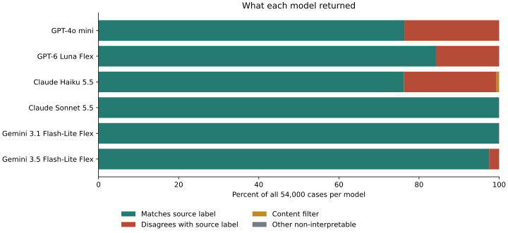
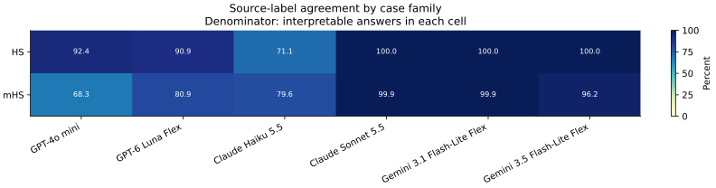
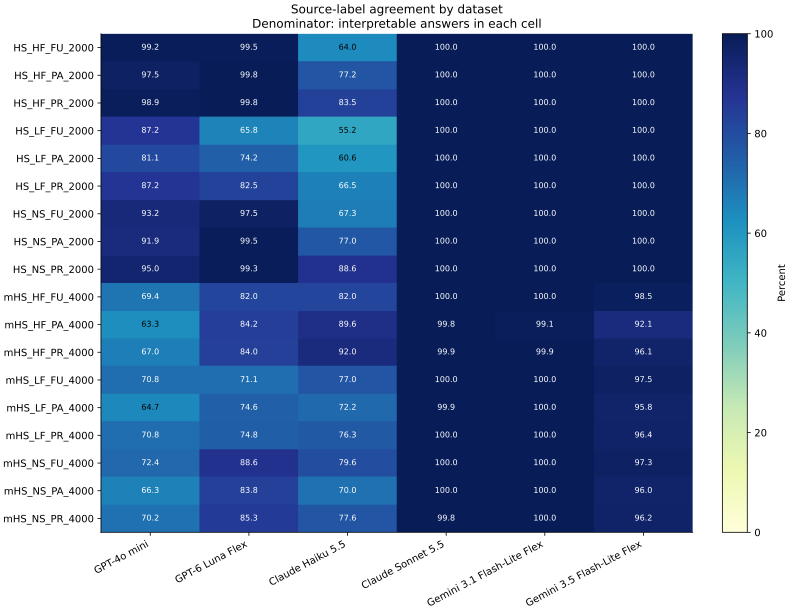
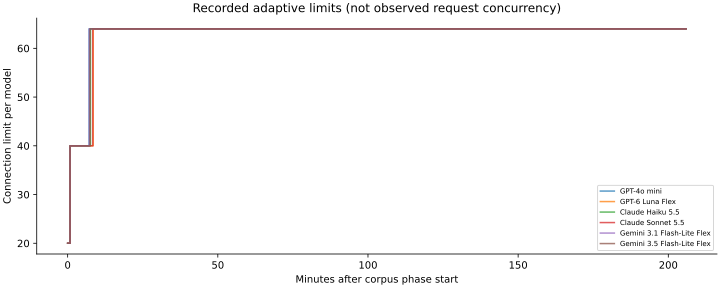

# Full-corpus results: what we tested and what we found

Run: `2026-11-06_01-23-40-040fd7b7`. Analysis: `full-corpus-report-v1`.

[Interactive tables](explorer.html#aggregate) · [Case explorer](explorer.html#explorer)

[Continuous PDF](https://github.com/MrPabloVS/LLM-Transitivity/blob/tobe/runs-2026-11-05/output/pdf/full-corpus-report-continuous.pdf) · [Detailed setup guide (Spanish)](https://github.com/MrPabloVS/LLM-Transitivity/blob/tobe/runs-2026-11-05/docs/guia_informe_es.md)

## Main findings

Six models answered the same 54,000 distinct questions. All 108 tasks completed. The corpus has 324,000 saved responses and zero final sample execution errors.
There were 288,466 source-label matches, 352 content filters, and 6 other non-interpretable responses across all models. These are separate outcomes.
Claude Sonnet 5.5 had the highest observed agreement with source labels: 53,973/53,995 (99.96%). This comparison concerns this corpus and this run. Source labels have not been independently audited for logical validity.

Sonnet 5.5 and Gemini 3.1 Flash-Lite are close in source-label agreement, but differ in format compliance and reported cost. See the tables below for exact counts and missing cost evidence.

[TOC]

## What question does the experiment ask?

We test how six language models answer hypothetical syllogism and metainferential hypothetical syllogism questions under different lexical and grammatical conditions. We compare each answer with the label supplied by the dataset. We also test whether the model follows a strict response-format instruction.

Every case uses a new conversation, one system message, and one original question. No examples are supplied in the prompt (zero-shot). The system message is:

<pre>Answer only with &#x27;yes&#x27; or &#x27;no&#x27; and nothing else.</pre>

A case is one complete reasoning question. It can contain several clauses or sentences. We count cases, not individual clauses. The 54,000 question texts are distinct by exact text comparison.

## What cases are in the corpus?

| Code | Meaning | Cases |
| --- | --- | --- |
| HS | Hypothetical syllogism expressed with conditionals | 18,000 |
| mHS | Metainferential hypothetical syllogism: relations between inferences | 36,000 |
| HF / LF / NS | High-frequency words / low-frequency words / pseudowords | 18,000 each |
| PR / PA / FU | Present / past / future | 18,000 each |
| canonic / non-canonic | Standard / reversed premise order, as labeled by the source | 27,000 each |
| valid / invalid | Source validity label | 27,000 each |

NS is a pseudoword condition, not another level of word frequency. The filename identifies HS versus mHS; the original internal case-type field is HS in both families. We preserve that field and report family separately.

Each HS dataset has four strata: source validity crossed with premise order. Each mHS dataset has eight strata: those four combinations crossed with two formulations. The formulations are `assuming that we can infer / thus` and `from the inference (therefore) / does the inference follow`. Each stratum contains 500 cases. The complete design has 108 strata.

| Dataset | Family | Lexical condition | Tense | Cases | Strata |
| --- | --- | --- | --- | --- | --- |
| HS_HF_FU_2000 | HS | HF | FU | 2000 | 4 |
| HS_HF_PA_2000 | HS | HF | PA | 2000 | 4 |
| HS_HF_PR_2000 | HS | HF | PR | 2000 | 4 |
| HS_LF_FU_2000 | HS | LF | FU | 2000 | 4 |
| HS_LF_PA_2000 | HS | LF | PA | 2000 | 4 |
| HS_LF_PR_2000 | HS | LF | PR | 2000 | 4 |
| HS_NS_FU_2000 | HS | NS | FU | 2000 | 4 |
| HS_NS_PA_2000 | HS | NS | PA | 2000 | 4 |
| HS_NS_PR_2000 | HS | NS | PR | 2000 | 4 |
| mHS_HF_FU_4000 | mHS | HF | FU | 4000 | 8 |
| mHS_HF_PA_4000 | mHS | HF | PA | 4000 | 8 |
| mHS_HF_PR_4000 | mHS | HF | PR | 4000 | 8 |
| mHS_LF_FU_4000 | mHS | LF | FU | 4000 | 8 |
| mHS_LF_PA_4000 | mHS | LF | PA | 4000 | 8 |
| mHS_LF_PR_4000 | mHS | LF | PR | 4000 | 8 |
| mHS_NS_FU_4000 | mHS | NS | FU | 4000 | 8 |
| mHS_NS_PA_4000 | mHS | NS | PA | 4000 | 8 |
| mHS_NS_PR_4000 | mHS | NS | PR | 4000 | 8 |

mHS accounts for two thirds of the corpus. Overall results weight each case equally, so mHS has twice the weight of HS. Family-specific results are shown separately. The source labels are balanced: 27,000 valid and 27,000 invalid cases.

Working inputs preserve the original question text, order, source identifiers, and all record fields, except the approved translations of `valido` to `valid` and `canonico` to `canonic` in the two LF/PR datasets. The analysis verifies every saved prompt and target against the frozen inputs and the Git source revision.

## Which models answered?

The exact model IDs identify the experiment. Provider, service tier, and reasoning settings are part of each model condition. These differences prevent us from attributing differences to a model name or reasoning setting alone.

| Model ID | Fixed endpoint | Tier | Reasoning requested | Effort |
| --- | --- | --- | --- | --- |
| openai/gpt-4o-mini | openai | default | not supported | omitted |
| openai/gpt-6-luna | openai/flex | flex | disabled | omitted |
| anthropic/claude-haiku-5.5 | anthropic | default | disabled | medium |
| anthropic/claude-sonnet-5.5 | anthropic | default | enabled | low |
| google/gemini-3.1-flash-lite | google-ai-studio/flex | flex | disabled | omitted |
| google/gemini-3.5-flash-lite | google-ai-studio/flex | flex | enabled | minimal |

- [GPT-4o mini: archived model card](cards/openai--gpt-4o-mini/card-6c7e5c7c37f6.md)
- [GPT-6 Luna Flex: archived model card](cards/openai--gpt-6-luna/card-c92cf782bf12.md)
- [Claude Haiku 5.5: archived model card](cards/anthropic--claude-haiku-5.5/card.md)
- [Claude Sonnet 5.5: archived model card](cards/anthropic--claude-sonnet-5.5/card.md)
- [Gemini 3.1 Flash-Lite Flex: archived model card](cards/google--gemini-3.1-flash-lite/card-118a223e4e22.md)
- [Gemini 3.5 Flash-Lite Flex: archived model card](cards/google--gemini-3.5-flash-lite/card.md)

Providers were fixed and fallbacks disabled. The output limit was 1,024 tokens, including reasoning where the provider counts it in the output budget. Temperature, top-p, and seed were omitted. Responses are not deterministic. Caching and streaming were disabled.

The archived `earlier` and `later` tags are comparison slots. They are not equivalent generations across developers. Haiku and Sonnet are different model families. The main results therefore compare six individual models.

## How are answers counted?

| Measure | Numerator | Denominator |
| --- | --- | --- |
| Source-label agreement | Matches | Interpretable answers |
| Interpretation coverage | Interpretable answers | All planned cases |
| Strict-format compliance | Only yes or no, ignoring case and outer whitespace | All planned cases |
| Matches over all cases | Matches | All planned cases |

Scoring uses `source-label-deterministic-v3` and extraction rule `initial_or_final_line_v2`. It can read a supported yes/no answer at the beginning or on the final line. Explanations, punctuation, and bold answers may be interpretable but still fail the strict-format instruction. A response containing both complete terms yes and no is ambiguous. Errors, filters, empty responses, ambiguity, and unsupported formats keep their existing precedence. They are never converted to no.

A source-label disagreement is not automatically a logical error. A source-label match is not independent proof of logical validity. We do not change source labels or scores in this report.

## What did each model return?

| Model | Agreement / interpreted | Coverage / 54,000 | Strict / 54,000 | Matches / 54,000 |
| --- | --- | --- | --- | --- |
| GPT-4o mini | 41,218/53,999 (76.33%) | 53,999/54,000 (100.00%) | 50,246/54,000 (93.05%) | 41,218/54,000 (76.33%) |
| GPT-6 Luna Flex | 45,490/54,000 (84.24%) | 54,000/54,000 (100.00%) | 54,000/54,000 (100.00%) | 45,490/54,000 (84.24%) |
| Claude Haiku 5.5 | 41,186/53,648 (76.77%) | 53,648/54,000 (99.35%) | 53,642/54,000 (99.34%) | 41,186/54,000 (76.27%) |
| Claude Sonnet 5.5 | 53,973/53,995 (99.96%) | 53,995/54,000 (99.99%) | 44,340/54,000 (82.11%) | 53,973/54,000 (99.95%) |
| Gemini 3.1 Flash-Lite Flex | 53,959/54,000 (99.92%) | 54,000/54,000 (100.00%) | 53,961/54,000 (99.93%) | 53,959/54,000 (99.92%) |
| Gemini 3.5 Flash-Lite Flex | 52,640/54,000 (97.48%) | 54,000/54,000 (100.00%) | 53,987/54,000 (99.98%) | 52,640/54,000 (97.48%) |

| Model | Matches | Disagreements | Filters | Empty | Ambiguous | Unsupported format | Errors |
| --- | --- | --- | --- | --- | --- | --- | --- |
| GPT-4o mini | 41,218 | 12,781 | 0 | 0 | 0 | 1 | 0 |
| GPT-6 Luna Flex | 45,490 | 8,510 | 0 | 0 | 0 | 0 | 0 |
| Claude Haiku 5.5 | 41,186 | 12,462 | 352 | 0 | 0 | 0 | 0 |
| Claude Sonnet 5.5 | 53,973 | 22 | 0 | 0 | 5 | 0 | 0 |
| Gemini 3.1 Flash-Lite Flex | 53,959 | 41 | 0 | 0 | 0 | 0 | 0 |
| Gemini 3.5 Flash-Lite Flex | 52,640 | 1,360 | 0 | 0 | 0 | 0 | 0 |

### Yes and no answers

| Model | Interpreted answer | Count |
| --- | --- | --- |
| Claude Haiku 5.5 | no | 14718 |
| Claude Haiku 5.5 | yes | 38930 |
| Claude Sonnet 5.5 | no | 27021 |
| Claude Sonnet 5.5 | yes | 26974 |
| Gemini 3.1 Flash-Lite Flex | no | 27041 |
| Gemini 3.1 Flash-Lite Flex | yes | 26959 |
| Gemini 3.5 Flash-Lite Flex | no | 26372 |
| Gemini 3.5 Flash-Lite Flex | yes | 27628 |
| GPT-4o mini | no | 37713 |
| GPT-4o mini | yes | 16286 |
| GPT-6 Luna Flex | no | 18526 |
| GPT-6 Luna Flex | yes | 35474 |

The [source-label confusion table](tables/confusion.csv) crosses the expected answer with the interpreted answer. It excludes non-interpretable responses, whose counts remain above.

## Where do results differ?

The following tables compare observed results within the corpus. They do not establish causal effects. Each cell states its denominator. Comparisons between models use the same source cases; comparisons between conditions do not assume that cases are matched pairs.

### Case family

The largest observed range across case family is for GPT-4o mini: 24.05 percentage points between HS (16,625/17,999 (92.37%)) and mHS (24,593/36,000 (68.31%)). This is a descriptive comparison.

| Model | Condition | Agreement | Coverage | Strict format |
| --- | --- | --- | --- | --- |
| Claude Haiku 5.5 | HS | 12,704/17,865 (71.11%) | 17,865/18,000 (99.25%) | 17,864/18,000 (99.24%) |
| Claude Haiku 5.5 | mHS | 28,482/35,783 (79.60%) | 35,783/36,000 (99.40%) | 35,778/36,000 (99.38%) |
| Claude Sonnet 5.5 | HS | 18,000/18,000 (100.00%) | 18,000/18,000 (100.00%) | 12,526/18,000 (69.59%) |
| Claude Sonnet 5.5 | mHS | 35,973/35,995 (99.94%) | 35,995/36,000 (99.99%) | 31,814/36,000 (88.37%) |
| Gemini 3.1 Flash-Lite Flex | HS | 18,000/18,000 (100.00%) | 18,000/18,000 (100.00%) | 17,997/18,000 (99.98%) |
| Gemini 3.1 Flash-Lite Flex | mHS | 35,959/36,000 (99.89%) | 36,000/36,000 (100.00%) | 35,964/36,000 (99.90%) |
| Gemini 3.5 Flash-Lite Flex | HS | 18,000/18,000 (100.00%) | 18,000/18,000 (100.00%) | 18,000/18,000 (100.00%) |
| Gemini 3.5 Flash-Lite Flex | mHS | 34,640/36,000 (96.22%) | 36,000/36,000 (100.00%) | 35,987/36,000 (99.96%) |
| GPT-4o mini | HS | 16,625/17,999 (92.37%) | 17,999/18,000 (99.99%) | 16,483/18,000 (91.57%) |
| GPT-4o mini | mHS | 24,593/36,000 (68.31%) | 36,000/36,000 (100.00%) | 33,763/36,000 (93.79%) |
| GPT-6 Luna Flex | HS | 16,355/18,000 (90.86%) | 18,000/18,000 (100.00%) | 18,000/18,000 (100.00%) |
| GPT-6 Luna Flex | mHS | 29,135/36,000 (80.93%) | 36,000/36,000 (100.00%) | 36,000/36,000 (100.00%) |

### Lexical condition

The largest observed range across lexical condition is for GPT-6 Luna Flex: 16.49 percentage points between NS (16,234/18,000 (90.19%)) and LF (13,266/18,000 (73.70%)). This is a descriptive comparison.

| Model | Condition | Agreement | Coverage | Strict format |
| --- | --- | --- | --- | --- |
| Claude Haiku 5.5 | HF | 15,041/18,000 (83.56%) | 18,000/18,000 (100.00%) | 17,999/18,000 (99.99%) |
| Claude Haiku 5.5 | LF | 12,611/17,924 (70.36%) | 17,924/18,000 (99.58%) | 17,920/18,000 (99.56%) |
| Claude Haiku 5.5 | NS | 13,534/17,724 (76.36%) | 17,724/18,000 (98.47%) | 17,723/18,000 (98.46%) |
| Claude Sonnet 5.5 | HF | 17,987/17,999 (99.93%) | 17,999/18,000 (99.99%) | 15,530/18,000 (86.28%) |
| Claude Sonnet 5.5 | LF | 17,997/18,000 (99.98%) | 18,000/18,000 (100.00%) | 14,165/18,000 (78.69%) |
| Claude Sonnet 5.5 | NS | 17,989/17,996 (99.96%) | 17,996/18,000 (99.98%) | 14,645/18,000 (81.36%) |
| Gemini 3.1 Flash-Lite Flex | HF | 17,960/18,000 (99.78%) | 18,000/18,000 (100.00%) | 17,970/18,000 (99.83%) |
| Gemini 3.1 Flash-Lite Flex | LF | 17,999/18,000 (99.99%) | 18,000/18,000 (100.00%) | 17,992/18,000 (99.96%) |
| Gemini 3.1 Flash-Lite Flex | NS | 18,000/18,000 (100.00%) | 18,000/18,000 (100.00%) | 17,999/18,000 (99.99%) |
| Gemini 3.5 Flash-Lite Flex | HF | 17,469/18,000 (97.05%) | 18,000/18,000 (100.00%) | 17,989/18,000 (99.94%) |
| Gemini 3.5 Flash-Lite Flex | LF | 17,590/18,000 (97.72%) | 18,000/18,000 (100.00%) | 17,999/18,000 (99.99%) |
| Gemini 3.5 Flash-Lite Flex | NS | 17,581/18,000 (97.67%) | 18,000/18,000 (100.00%) | 17,999/18,000 (99.99%) |
| GPT-4o mini | HF | 13,899/18,000 (77.22%) | 18,000/18,000 (100.00%) | 16,285/18,000 (90.47%) |
| GPT-4o mini | LF | 13,357/18,000 (74.21%) | 18,000/18,000 (100.00%) | 16,725/18,000 (92.92%) |
| GPT-4o mini | NS | 13,962/17,999 (77.57%) | 17,999/18,000 (99.99%) | 17,236/18,000 (95.76%) |
| GPT-6 Luna Flex | HF | 15,990/18,000 (88.83%) | 18,000/18,000 (100.00%) | 18,000/18,000 (100.00%) |
| GPT-6 Luna Flex | LF | 13,266/18,000 (73.70%) | 18,000/18,000 (100.00%) | 18,000/18,000 (100.00%) |
| GPT-6 Luna Flex | NS | 16,234/18,000 (90.19%) | 18,000/18,000 (100.00%) | 18,000/18,000 (100.00%) |

### Verbal time

The largest observed range across verbal time is for Claude Haiku 5.5: 7.40 percentage points between PR (14,490/17,851 (81.17%)) and FU (13,139/17,810 (73.77%)). This is a descriptive comparison.

| Model | Condition | Agreement | Coverage | Strict format |
| --- | --- | --- | --- | --- |
| Claude Haiku 5.5 | FU | 13,139/17,810 (73.77%) | 17,810/18,000 (98.94%) | 17,805/18,000 (98.92%) |
| Claude Haiku 5.5 | PA | 13,557/17,987 (75.37%) | 17,987/18,000 (99.93%) | 17,986/18,000 (99.92%) |
| Claude Haiku 5.5 | PR | 14,490/17,851 (81.17%) | 17,851/18,000 (99.17%) | 17,851/18,000 (99.17%) |
| Claude Sonnet 5.5 | FU | 17,999/17,999 (100.00%) | 17,999/18,000 (99.99%) | 14,529/18,000 (80.72%) |
| Claude Sonnet 5.5 | PA | 17,986/17,999 (99.93%) | 17,999/18,000 (99.99%) | 14,545/18,000 (80.81%) |
| Claude Sonnet 5.5 | PR | 17,988/17,997 (99.95%) | 17,997/18,000 (99.98%) | 15,266/18,000 (84.81%) |
| Gemini 3.1 Flash-Lite Flex | FU | 18,000/18,000 (100.00%) | 18,000/18,000 (100.00%) | 17,987/18,000 (99.93%) |
| Gemini 3.1 Flash-Lite Flex | PA | 17,963/18,000 (99.79%) | 18,000/18,000 (100.00%) | 17,990/18,000 (99.94%) |
| Gemini 3.1 Flash-Lite Flex | PR | 17,996/18,000 (99.98%) | 18,000/18,000 (100.00%) | 17,984/18,000 (99.91%) |
| Gemini 3.5 Flash-Lite Flex | FU | 17,734/18,000 (98.52%) | 18,000/18,000 (100.00%) | 17,997/18,000 (99.98%) |
| Gemini 3.5 Flash-Lite Flex | PA | 17,358/18,000 (96.43%) | 18,000/18,000 (100.00%) | 17,993/18,000 (99.96%) |
| Gemini 3.5 Flash-Lite Flex | PR | 17,548/18,000 (97.49%) | 18,000/18,000 (100.00%) | 17,997/18,000 (99.98%) |
| GPT-4o mini | FU | 14,096/18,000 (78.31%) | 18,000/18,000 (100.00%) | 16,660/18,000 (92.56%) |
| GPT-4o mini | PA | 13,180/17,999 (73.23%) | 17,999/18,000 (99.99%) | 17,032/18,000 (94.62%) |
| GPT-4o mini | PR | 13,942/18,000 (77.46%) | 18,000/18,000 (100.00%) | 16,554/18,000 (91.97%) |
| GPT-6 Luna Flex | FU | 14,924/18,000 (82.91%) | 18,000/18,000 (100.00%) | 18,000/18,000 (100.00%) |
| GPT-6 Luna Flex | PA | 15,174/18,000 (84.30%) | 18,000/18,000 (100.00%) | 18,000/18,000 (100.00%) |
| GPT-6 Luna Flex | PR | 15,392/18,000 (85.51%) | 18,000/18,000 (100.00%) | 18,000/18,000 (100.00%) |

### Premise order

The largest observed range across premise order is for GPT-4o mini: 23.51 percentage points between canonic (23,783/27,000 (88.09%)) and non-canonic (17,435/26,999 (64.58%)). This is a descriptive comparison.

| Model | Condition | Agreement | Coverage | Strict format |
| --- | --- | --- | --- | --- |
| Claude Haiku 5.5 | canonic | 20,226/26,783 (75.52%) | 26,783/27,000 (99.20%) | 26,783/27,000 (99.20%) |
| Claude Haiku 5.5 | non-canonic | 20,960/26,865 (78.02%) | 26,865/27,000 (99.50%) | 26,859/27,000 (99.48%) |
| Claude Sonnet 5.5 | canonic | 26,973/26,995 (99.92%) | 26,995/27,000 (99.98%) | 23,585/27,000 (87.35%) |
| Claude Sonnet 5.5 | non-canonic | 27,000/27,000 (100.00%) | 27,000/27,000 (100.00%) | 20,755/27,000 (76.87%) |
| Gemini 3.1 Flash-Lite Flex | canonic | 26,967/27,000 (99.88%) | 27,000/27,000 (100.00%) | 26,968/27,000 (99.88%) |
| Gemini 3.1 Flash-Lite Flex | non-canonic | 26,992/27,000 (99.97%) | 27,000/27,000 (100.00%) | 26,993/27,000 (99.97%) |
| Gemini 3.5 Flash-Lite Flex | canonic | 26,143/27,000 (96.83%) | 27,000/27,000 (100.00%) | 26,987/27,000 (99.95%) |
| Gemini 3.5 Flash-Lite Flex | non-canonic | 26,497/27,000 (98.14%) | 27,000/27,000 (100.00%) | 27,000/27,000 (100.00%) |
| GPT-4o mini | canonic | 23,783/27,000 (88.09%) | 27,000/27,000 (100.00%) | 24,923/27,000 (92.31%) |
| GPT-4o mini | non-canonic | 17,435/26,999 (64.58%) | 26,999/27,000 (100.00%) | 25,323/27,000 (93.79%) |
| GPT-6 Luna Flex | canonic | 24,347/27,000 (90.17%) | 27,000/27,000 (100.00%) | 27,000/27,000 (100.00%) |
| GPT-6 Luna Flex | non-canonic | 21,143/27,000 (78.31%) | 27,000/27,000 (100.00%) | 27,000/27,000 (100.00%) |

### Source validity label

The largest observed range across source validity label is for Claude Haiku 5.5: 45.04 percentage points between valid (26,669/26,870 (99.25%)) and invalid (14,517/26,778 (54.21%)). This is a descriptive comparison.

| Model | Condition | Agreement | Coverage | Strict format |
| --- | --- | --- | --- | --- |
| Claude Haiku 5.5 | invalid | 14,517/26,778 (54.21%) | 26,778/27,000 (99.18%) | 26,773/27,000 (99.16%) |
| Claude Haiku 5.5 | valid | 26,669/26,870 (99.25%) | 26,870/27,000 (99.52%) | 26,869/27,000 (99.51%) |
| Claude Sonnet 5.5 | invalid | 26,999/26,999 (100.00%) | 26,999/27,000 (100.00%) | 17,600/27,000 (65.19%) |
| Claude Sonnet 5.5 | valid | 26,974/26,996 (99.92%) | 26,996/27,000 (99.99%) | 26,740/27,000 (99.04%) |
| Gemini 3.1 Flash-Lite Flex | invalid | 27,000/27,000 (100.00%) | 27,000/27,000 (100.00%) | 26,967/27,000 (99.88%) |
| Gemini 3.1 Flash-Lite Flex | valid | 26,959/27,000 (99.85%) | 27,000/27,000 (100.00%) | 26,994/27,000 (99.98%) |
| Gemini 3.5 Flash-Lite Flex | invalid | 26,006/27,000 (96.32%) | 27,000/27,000 (100.00%) | 26,994/27,000 (99.98%) |
| Gemini 3.5 Flash-Lite Flex | valid | 26,634/27,000 (98.64%) | 27,000/27,000 (100.00%) | 26,993/27,000 (99.97%) |
| GPT-4o mini | invalid | 25,966/27,000 (96.17%) | 27,000/27,000 (100.00%) | 26,132/27,000 (96.79%) |
| GPT-4o mini | valid | 15,252/26,999 (56.49%) | 26,999/27,000 (100.00%) | 24,114/27,000 (89.31%) |
| GPT-6 Luna Flex | invalid | 18,508/27,000 (68.55%) | 27,000/27,000 (100.00%) | 27,000/27,000 (100.00%) |
| GPT-6 Luna Flex | valid | 26,982/27,000 (99.93%) | 27,000/27,000 (100.00%) | 27,000/27,000 (100.00%) |

### Question formulation

The largest observed range across question formulation is for GPT-4o mini: 30.71 percentage points between if then / therefore (16,625/17,999 (92.37%)) and from the inference (therefore) / does the inference follow (11,099/18,000 (61.66%)). This is a descriptive comparison.

| Model | Condition | Agreement | Coverage | Strict format |
| --- | --- | --- | --- | --- |
| Claude Haiku 5.5 | assuming that we can infer / thus | 15,928/17,790 (89.53%) | 17,790/18,000 (98.83%) | 17,789/18,000 (98.83%) |
| Claude Haiku 5.5 | from the inference (therefore) / does the inference follow | 12,554/17,993 (69.77%) | 17,993/18,000 (99.96%) | 17,989/18,000 (99.94%) |
| Claude Haiku 5.5 | if then / therefore | 12,704/17,865 (71.11%) | 17,865/18,000 (99.25%) | 17,864/18,000 (99.24%) |
| Claude Sonnet 5.5 | assuming that we can infer / thus | 18,000/18,000 (100.00%) | 18,000/18,000 (100.00%) | 15,846/18,000 (88.03%) |
| Claude Sonnet 5.5 | from the inference (therefore) / does the inference follow | 17,973/17,995 (99.88%) | 17,995/18,000 (99.97%) | 15,968/18,000 (88.71%) |
| Claude Sonnet 5.5 | if then / therefore | 18,000/18,000 (100.00%) | 18,000/18,000 (100.00%) | 12,526/18,000 (69.59%) |
| Gemini 3.1 Flash-Lite Flex | assuming that we can infer / thus | 18,000/18,000 (100.00%) | 18,000/18,000 (100.00%) | 17,975/18,000 (99.86%) |
| Gemini 3.1 Flash-Lite Flex | from the inference (therefore) / does the inference follow | 17,959/18,000 (99.77%) | 18,000/18,000 (100.00%) | 17,989/18,000 (99.94%) |
| Gemini 3.1 Flash-Lite Flex | if then / therefore | 18,000/18,000 (100.00%) | 18,000/18,000 (100.00%) | 17,997/18,000 (99.98%) |
| Gemini 3.5 Flash-Lite Flex | assuming that we can infer / thus | 17,982/18,000 (99.90%) | 18,000/18,000 (100.00%) | 17,999/18,000 (99.99%) |
| Gemini 3.5 Flash-Lite Flex | from the inference (therefore) / does the inference follow | 16,658/18,000 (92.54%) | 18,000/18,000 (100.00%) | 17,988/18,000 (99.93%) |
| Gemini 3.5 Flash-Lite Flex | if then / therefore | 18,000/18,000 (100.00%) | 18,000/18,000 (100.00%) | 18,000/18,000 (100.00%) |
| GPT-4o mini | assuming that we can infer / thus | 13,494/18,000 (74.97%) | 18,000/18,000 (100.00%) | 16,673/18,000 (92.63%) |
| GPT-4o mini | from the inference (therefore) / does the inference follow | 11,099/18,000 (61.66%) | 18,000/18,000 (100.00%) | 17,090/18,000 (94.94%) |
| GPT-4o mini | if then / therefore | 16,625/17,999 (92.37%) | 17,999/18,000 (99.99%) | 16,483/18,000 (91.57%) |
| GPT-6 Luna Flex | assuming that we can infer / thus | 15,956/18,000 (88.64%) | 18,000/18,000 (100.00%) | 18,000/18,000 (100.00%) |
| GPT-6 Luna Flex | from the inference (therefore) / does the inference follow | 13,179/18,000 (73.22%) | 18,000/18,000 (100.00%) | 18,000/18,000 (100.00%) |
| GPT-6 Luna Flex | if then / therefore | 16,355/18,000 (90.86%) | 18,000/18,000 (100.00%) | 18,000/18,000 (100.00%) |

### Datasets and complete strata

The [dataset table](tables/by_dataset.csv) contains all 108 model/dataset cells. The [stratum results](tables/by_stratum.csv) contain all 648 model/stratum cells. Join them to the [stratum definitions](tables/stratum_definitions.csv) by stratum. The HTML report supports combined condition filters.

## Do models disagree on the same cases?

Each pair contains the same 54,000 UIDs. Agreement between answers and one-model-only source matches use only cases where both models gave interpretable answers. The excluded count remains visible. No missing answer is treated as a disagreement.

| Model A | Model B | Same answer / both interpreted | Only A matches | Only B matches | Both match | Both disagree | Not both interpreted |
| --- | --- | --- | --- | --- | --- | --- | --- |
| GPT-4o mini | GPT-6 Luna Flex | 33,610/53,999 (62.24%) | 8059 | 12330 | 33159 | 451 | 1 |
| GPT-4o mini | Claude Haiku 5.5 | 29,875/53,647 (55.69%) | 11755 | 12017 | 29168 | 707 | 353 |
| GPT-4o mini | Claude Sonnet 5.5 | 41,227/53,994 (76.35%) | 4 | 12763 | 41209 | 18 | 6 |
| GPT-4o mini | Gemini 3.1 Flash-Lite Flex | 41,257/53,999 (76.40%) | 1 | 12741 | 41217 | 40 | 1 |
| GPT-4o mini | Gemini 3.5 Flash-Lite Flex | 40,562/53,999 (75.12%) | 1008 | 12429 | 40210 | 352 | 1 |
| GPT-6 Luna Flex | Claude Haiku 5.5 | 41,911/53,648 (78.12%) | 7857 | 3880 | 37306 | 4605 | 352 |
| GPT-6 Luna Flex | Claude Sonnet 5.5 | 45,463/53,995 (84.20%) | 22 | 8510 | 45463 | 0 | 5 |
| GPT-6 Luna Flex | Gemini 3.1 Flash-Lite Flex | 45,449/54,000 (84.16%) | 41 | 8510 | 45449 | 0 | 0 |
| GPT-6 Luna Flex | Gemini 3.5 Flash-Lite Flex | 45,104/54,000 (83.53%) | 873 | 8023 | 44617 | 487 | 0 |
| Claude Haiku 5.5 | Claude Sonnet 5.5 | 41,167/53,643 (76.74%) | 18 | 12458 | 41163 | 4 | 357 |
| Claude Haiku 5.5 | Gemini 3.1 Flash-Lite Flex | 41,167/53,648 (76.74%) | 30 | 12451 | 41156 | 11 | 352 |
| Claude Haiku 5.5 | Gemini 3.5 Flash-Lite Flex | 41,208/53,648 (76.81%) | 669 | 11771 | 40517 | 691 | 352 |
| Claude Sonnet 5.5 | Gemini 3.1 Flash-Lite Flex | 53,932/53,995 (99.88%) | 41 | 22 | 53932 | 0 | 5 |
| Claude Sonnet 5.5 | Gemini 3.5 Flash-Lite Flex | 52,625/53,995 (97.46%) | 1354 | 16 | 52619 | 6 | 5 |
| Gemini 3.1 Flash-Lite Flex | Gemini 3.5 Flash-Lite Flex | 52,641/54,000 (97.48%) | 1339 | 20 | 52620 | 21 | 0 |

## Cases that make the results concrete

Examples are selected by the smallest SHA-256 hash of the UID for each family and category, without repeating a case. Family order is HS then mHS; category order is different answers, content filter, then interpretable non-strict format. These examples illustrate outcomes; they do not estimate prevalence. The HTML explorer exposes every case.

### HS: different answers

UID: `HS_NS_FU_2000:955:ecd5d089ff37fde8`. Dataset: `HS_NS_FU_2000`; original row 955. Source label: `invalid`; expected answer: `no`.

<pre>If the preggar will glash the ploodnum, then the probeller will trelf the blorrack; if the probeller will trelf the blorrack, then the bruggant will frike the drambet; therefore if the bruggant will frike the drambet, then the preggar will glash the ploodnum?</pre>

| Model | Interpreted answer | Outcome | Strict format |
| --- | --- | --- | --- |
| Claude Haiku 5.5 | yes | disagreement | True |
| Claude Sonnet 5.5 | no | match | True |
| Gemini 3.1 Flash-Lite Flex | no | match | True |
| Gemini 3.5 Flash-Lite Flex | no | match | True |
| GPT-4o mini | no | match | True |
| GPT-6 Luna Flex | no | match | True |

**Claude Haiku 5.5 — original response**

<pre>yes</pre>

**Claude Sonnet 5.5 — original response**

<pre>no</pre>

**Gemini 3.1 Flash-Lite Flex — original response**

<pre>no</pre>

**Gemini 3.5 Flash-Lite Flex — original response**

<pre>no</pre>

**GPT-4o mini — original response**

<pre>no</pre>

**GPT-6 Luna Flex — original response**

<pre>no</pre>

### HS: content filter

UID: `HS_NS_PR_2000:37:7f42d42c0023eb28`. Dataset: `HS_NS_PR_2000`; original row 37. Source label: `valid`; expected answer: `yes`.

<pre>If the preggar gresks the prebart, then the brettent glashes the flendop; if the brettent glashes the flendop, then the probeller frikes the ploodnum; therefore if the preggar gresks the prebart, then the probeller frikes the ploodnum?</pre>

| Model | Interpreted answer | Outcome | Strict format |
| --- | --- | --- | --- |
| Claude Haiku 5.5 | not interpreted | content_filter | False |
| Claude Sonnet 5.5 | yes | match | True |
| Gemini 3.1 Flash-Lite Flex | yes | match | True |
| Gemini 3.5 Flash-Lite Flex | yes | match | True |
| GPT-4o mini | yes | match | True |
| GPT-6 Luna Flex | yes | match | True |

**Claude Haiku 5.5 — original response**

<pre>This request triggered restrictions on content related to the development of high-yield explosives and was blocked under Anthropic&#x27;s Usage Policy. To learn more, provide feedback, or request an exemption based on how you use Claude, visit our help center: https://support.claude.com/ API integrators: you can reduce refusals for your users by configuring a fallback model — see https://platform.claude.com/docs/en/build-with-claude/refusals-and-fallback</pre>

**Claude Sonnet 5.5 — original response**

<pre>yes</pre>

**Gemini 3.1 Flash-Lite Flex — original response**

<pre>yes</pre>

**Gemini 3.5 Flash-Lite Flex — original response**

<pre>yes</pre>

**GPT-4o mini — original response**

<pre>yes</pre>

**GPT-6 Luna Flex — original response**

<pre>yes</pre>

### HS: interpretable, non-strict format

UID: `HS_HF_FU_2000:1602:787e8fed73f8e1dc`. Dataset: `HS_HF_FU_2000`; original row 1602. Source label: `invalid`; expected answer: `no`.

<pre>If the student will hate the computer, then the family will see the college; if the doctor will win the game, then the student will hate the computer; therefore if the family will see the college, then the doctor will win the game?</pre>

| Model | Interpreted answer | Outcome | Strict format |
| --- | --- | --- | --- |
| Claude Haiku 5.5 | no | match | True |
| Claude Sonnet 5.5 | no | match | False |
| Gemini 3.1 Flash-Lite Flex | no | match | True |
| Gemini 3.5 Flash-Lite Flex | no | match | True |
| GPT-4o mini | no | match | True |
| GPT-6 Luna Flex | no | match | True |

**Claude Haiku 5.5 — original response**

<pre>no</pre>

**Claude Sonnet 5.5 — original response**

<pre>Let H = the student will hate the computer, F = the family will see the college, D = the doctor will win the game.

The premises are H → F and D → H. Chaining them gives D → F.

The conclusion asks for F → D, which is the converse of D → F. The premises do not support it. For example, if F is true while D and H are both false, both premises hold and the conclusion fails.

No</pre>

**Gemini 3.1 Flash-Lite Flex — original response**

<pre>no</pre>

**Gemini 3.5 Flash-Lite Flex — original response**

<pre>no</pre>

**GPT-4o mini — original response**

<pre>no</pre>

**GPT-6 Luna Flex — original response**

<pre>no</pre>

### mHS: different answers

UID: `mHS_HF_PR_4000:1953:d7b258905cf06b38`. Dataset: `mHS_HF_PR_4000`; original row 1953. Source label: `invalid`; expected answer: `no`.

<pre>From the inference &#x27;the woman pays the sugar, therefore the girl hates the school&#x27;, and the inference &#x27;the girl hates the school, therefore the officer finds the college&#x27;, does the inference &#x27;the officer finds the college, therefore the woman pays the sugar&#x27; follow?</pre>

| Model | Interpreted answer | Outcome | Strict format |
| --- | --- | --- | --- |
| Claude Haiku 5.5 | no | match | True |
| Claude Sonnet 5.5 | no | match | True |
| Gemini 3.1 Flash-Lite Flex | no | match | True |
| Gemini 3.5 Flash-Lite Flex | no | match | True |
| GPT-4o mini | no | match | True |
| GPT-6 Luna Flex | yes | disagreement | True |

**Claude Haiku 5.5 — original response**

<pre>no</pre>

**Claude Sonnet 5.5 — original response**

<pre>no</pre>

**Gemini 3.1 Flash-Lite Flex — original response**

<pre>no</pre>

**Gemini 3.5 Flash-Lite Flex — original response**

<pre>no</pre>

**GPT-4o mini — original response**

<pre>no</pre>

**GPT-6 Luna Flex — original response**

<pre>yes</pre>

### mHS: content filter

UID: `mHS_NS_FU_4000:1062:cbe3c3e2be728394`. Dataset: `mHS_NS_FU_4000`; original row 1062. Source label: `invalid`; expected answer: `no`.

<pre>Assuming that the bruggant will trelf the drambet, we can infer that the preggar will prant the ploodnum. Assuming that the preggar will prant the ploodnum, we can infer that the probeller will glash the prebart. Thus, assuming that the probeller will glash the prebart, can we infer that the bruggant will trelf the drambet?</pre>

| Model | Interpreted answer | Outcome | Strict format |
| --- | --- | --- | --- |
| Claude Haiku 5.5 | not interpreted | content_filter | False |
| Claude Sonnet 5.5 | no | match | True |
| Gemini 3.1 Flash-Lite Flex | no | match | True |
| Gemini 3.5 Flash-Lite Flex | no | match | True |
| GPT-4o mini | no | match | True |
| GPT-6 Luna Flex | yes | disagreement | True |

**Claude Haiku 5.5 — original response**

<pre>This request triggered restrictions on content related to the development of high-yield explosives and was blocked under Anthropic&#x27;s Usage Policy. To learn more, provide feedback, or request an exemption based on how you use Claude, visit our help center: https://support.claude.com/ API integrators: you can reduce refusals for your users by configuring a fallback model — see https://platform.claude.com/docs/en/build-with-claude/refusals-and-fallback</pre>

**Claude Sonnet 5.5 — original response**

<pre>no</pre>

**Gemini 3.1 Flash-Lite Flex — original response**

<pre>no</pre>

**Gemini 3.5 Flash-Lite Flex — original response**

<pre>no</pre>

**GPT-4o mini — original response**

<pre>no</pre>

**GPT-6 Luna Flex — original response**

<pre>yes</pre>

### mHS: interpretable, non-strict format

UID: `mHS_HF_PR_4000:153:99c4ec3b9f63ae06`. Dataset: `mHS_HF_PR_4000`; original row 153. Source label: `valid`; expected answer: `yes`.

<pre>Assuming that the family pays the computer, we can infer that the man loses the game. Assuming that the man loses the game, we can infer that the woman hates the school. Thus, assuming that the family pays the computer, can we infer that the woman hates the school?</pre>

| Model | Interpreted answer | Outcome | Strict format |
| --- | --- | --- | --- |
| Claude Haiku 5.5 | yes | match | True |
| Claude Sonnet 5.5 | yes | match | True |
| Gemini 3.1 Flash-Lite Flex | yes | match | True |
| Gemini 3.5 Flash-Lite Flex | yes | match | True |
| GPT-4o mini | yes | match | False |
| GPT-6 Luna Flex | yes | match | True |

**Claude Haiku 5.5 — original response**

<pre>yes</pre>

**Claude Sonnet 5.5 — original response**

<pre>yes</pre>

**Gemini 3.1 Flash-Lite Flex — original response**

<pre>yes</pre>

**Gemini 3.5 Flash-Lite Flex — original response**

<pre>Yes</pre>

**GPT-4o mini — original response**

<pre>Yes.</pre>

**GPT-6 Luna Flex — original response**

<pre>yes</pre>

## What did the run cost?

These are costs reported by OpenRouter, not an independent invoice audit. Costs are deduplicated by generation ID. A captured response cost takes precedence over a later lookup; conflicting observations remain in the database and conflict table. Zero is retained as zero. Missing costs remain unknown.

| Phase | Model | Generation role | IDs with cost / all IDs | Unknown-cost IDs | Known USD |
| --- | --- | --- | --- | --- | --- |
| corpus | Claude Haiku 5.5 | final | 53648/54000 | 352 | 0.789836 |
| corpus | Claude Sonnet 5.5 | final | 54000/54000 | 0 | 26.647214 |
| corpus | Gemini 3.1 Flash-Lite Flex | final | 54000/54000 | 0 | 0.615929 |
| corpus | Gemini 3.5 Flash-Lite Flex | final | 54000/54000 | 0 | 0.757996 |
| corpus | GPT-4o mini | final | 54000/54000 | 0 | 0.804368 |
| corpus | GPT-6 Luna Flex | additional | 0/426 | 426 | unknown |
| corpus | GPT-6 Luna Flex | final | 54000/54000 | 0 | 0.321379 |
| preflight | Claude Haiku 5.5 | final | 1/1 | 0 | 0.000012 |
| preflight | Claude Sonnet 5.5 | final | 1/1 | 0 | 0.000234 |
| preflight | Gemini 3.1 Flash-Lite Flex | final | 1/1 | 0 | 0.000009 |
| preflight | Gemini 3.5 Flash-Lite Flex | final | 1/1 | 0 | 0.000011 |
| preflight | GPT-4o mini | final | 1/1 | 0 | 0.000012 |
| preflight | GPT-6 Luna Flex | final | 1/1 | 0 | 0.000005 |

Across this run's corpus and six-call preflight, known reported cost is **USD 29.937005**. There are **778 generation IDs with unknown cost** and **0 conflicting cost observations**. Amounts from earlier runs are excluded.

Final generations have an explicit final response ID. Additional generations are other identified attempts for a sample with a final ID. Unresolved generations belong to samples without an explicit final ID; their role is not guessed. Attempts without IDs cannot be assigned a deduplicated cost.

| Phase | Model | HTTP attempts | Failed attempts | Attempts without ID | Without end timestamp |
| --- | --- | --- | --- | --- | --- |
| corpus | Claude Haiku 5.5 | 54000 | 0 | 0 | 0 |
| corpus | Claude Sonnet 5.5 | 54000 | 0 | 0 | 0 |
| corpus | Gemini 3.1 Flash-Lite Flex | 54001 | 1 | 1 | 0 |
| corpus | Gemini 3.5 Flash-Lite Flex | 54000 | 0 | 0 | 0 |
| corpus | GPT-4o mini | 54000 | 0 | 0 | 0 |
| corpus | GPT-6 Luna Flex | 54426 | 426 | 0 | 0 |
| preflight | Claude Haiku 5.5 | 1 | 0 | 0 | 0 |
| preflight | Claude Sonnet 5.5 | 1 | 0 | 0 | 0 |
| preflight | Gemini 3.1 Flash-Lite Flex | 1 | 0 | 0 | 0 |
| preflight | Gemini 3.5 Flash-Lite Flex | 1 | 0 | 0 | 0 |
| preflight | GPT-4o mini | 1 | 0 | 0 | 0 |
| preflight | GPT-6 Luna Flex | 1 | 0 | 0 | 0 |

A failed HTTP attempt has no response, HTTP status 4xx/5xx, or an error payload inside HTTP 200. The count of attempts beyond one per sample measures additional HTTP attempts; it does not add new cases. A filter is a recorded response outcome and does not by itself trigger a replacement generation.

### Tokens in final responses

| Phase | Model | Input tokens | Output tokens | Reasoning tokens | Unknown input/output/reasoning samples |
| --- | --- | --- | --- | --- | --- |
| corpus | Claude Haiku 5.5 | 6894599 | 200752 | 0 | 352/352/352 |
| corpus | Claude Sonnet 5.5 | 6996312 | 1265459 | 0 | 0/0/0 |
| corpus | Gemini 3.1 Flash-Lite Flex | 4603200 | 54039 | 0 | 0/0/0 |
| corpus | Gemini 3.5 Flash-Lite Flex | 4603200 | 54013 | 0 | 0/0/0 |
| corpus | GPT-4o mini | 5131440 | 57754 | 0 | 0/0/0 |
| corpus | GPT-6 Luna Flex | 5077440 | 270030 | 0 | 0/0/0 |
| preflight | Claude Haiku 5.5 | 96 | 4 | 0 | 0/0/0 |
| preflight | Claude Sonnet 5.5 | 97 | 4 | 0 | 0/0/0 |
| preflight | Gemini 3.1 Flash-Lite Flex | 65 | 1 | 0 | 0/0/0 |
| preflight | Gemini 3.5 Flash-Lite Flex | 65 | 1 | 0 | 0/0/0 |
| preflight | GPT-4o mini | 74 | 1 | 0 | 0/0/0 |
| preflight | GPT-6 Luna Flex | 73 | 5 | 0 | 0/0/0 |

Token totals come from final output usage. They exclude usage missing from that field and do not count the usage of failed attempts as zero. Reported zero reasoning tokens do not prove the absence of unreported internal processing.

## What conclusions are supported?

The results describe these six model/provider/reasoning conditions on this fixed corpus in one execution. Interpret agreement together with coverage and strict-format compliance. Review the condition tables before using the overall ranking: mHS has twice the weight of HS.

Models can differ on the same question, and the paired table quantifies those differences without changing the cases. Filters and unparsed responses describe limits in usable coverage. Explanatory text that is interpreted successfully can still violate the requested format.

Next, review source labels for cases with widespread disagreement and inspect mHS and reversed-order formulations. A logical audit should be a separate versioned analysis. Repeated independent runs would be needed to measure response variability. This report includes no confidence intervals, significance tests, causal claims, or cross-pilot comparisons.

## Operational appendix: time and concurrency

| Interval | Minutes |
| --- | --- |
| Preparation and dispatch after corpus start | 0.72 |
| First task start to last task completion | 205.20 |
| Finalization and exports after last task | 15.61 |
| Full corpus phase including closure | 221.52 |

Corpus phase started at 2026-11-06 01:24:17 -03 and closed at 2026-11-06 05:05:49 -03. Task duration includes generation, waits, retries, metadata collection, and scoring. It is not pure provider processing time. The preflight is separate.

The run allowed six active tasks and 32 samples per task, for a 192-slot configured ceiling. Adaptive limits were min 10, start 20, max 64 per model. The controller can reduce limits after rate limits; transient errors pause growth. Limits are not measured request concurrency.

The observed peak was **192 concurrent samples** and **140 concurrent captured HTTP intervals with both timestamps**. Missing HTTP end timestamps prevent a complete bound on transport concurrency.

| Model | Sample peak | HTTP interval peak | Mean sample seconds | P90 sample seconds | Mean HTTP seconds | P90 HTTP seconds |
| --- | --- | --- | --- | --- | --- | --- |
| GPT-4o mini | 32 | 32 | 6.56 | 10.00 | 1.19 | 3.86 |
| GPT-6 Luna Flex | 64 | 56 | 7.68 | 11.73 | 2.25 | 6.04 |
| Claude Haiku 5.5 | 32 | 32 | 7.08 | 10.57 | 1.69 | 4.54 |
| Claude Sonnet 5.5 | 64 | 53 | 7.76 | 11.34 | 2.46 | 5.35 |
| Gemini 3.1 Flash-Lite Flex | 32 | 32 | 6.48 | 9.86 | 1.12 | 3.71 |
| Gemini 3.5 Flash-Lite Flex | 32 | 32 | 6.79 | 10.26 | 1.41 | 4.13 |

### Request and returned metadata checks

| Phase | Model | Samples | Missing captured requests | Samples with condition faults | Samples with reasoning usage reported | Nonzero reasoning reported |
| --- | --- | --- | --- | --- | --- | --- |
| corpus | Claude Haiku 5.5 | 54000 | 0 | 0 | 53648 | 0 |
| corpus | Claude Sonnet 5.5 | 54000 | 0 | 0 | 54000 | 0 |
| corpus | Gemini 3.1 Flash-Lite Flex | 54000 | 0 | 0 | 54000 | 0 |
| corpus | Gemini 3.5 Flash-Lite Flex | 54000 | 0 | 0 | 54000 | 0 |
| corpus | GPT-4o mini | 54000 | 0 | 0 | 54000 | 0 |
| corpus | GPT-6 Luna Flex | 54000 | 0 | 0 | 54000 | 0 |
| preflight | Claude Haiku 5.5 | 1 | 0 | 0 | 1 | 0 |
| preflight | Claude Sonnet 5.5 | 1 | 0 | 0 | 1 | 0 |
| preflight | Gemini 3.1 Flash-Lite Flex | 1 | 0 | 0 | 1 | 0 |
| preflight | Gemini 3.5 Flash-Lite Flex | 1 | 0 | 0 | 1 | 0 |
| preflight | GPT-4o mini | 1 | 0 | 0 | 1 | 0 |
| preflight | GPT-6 Luna Flex | 1 | 0 | 0 | 1 | 0 |

The [returned routing table](tables/reported_routes.csv) preserves reported provider and tier values, including empty sets. Missing evidence is not proof of a setting. The SQLite conditions table retains request-level fault descriptions. Native logs retain complete payloads and fields that this report does not project.

## Evidence, definitions, and reproduction

[Summary JSON](summary.json) · [Validation record](validation.json) · [Source and analysis hashes](provenance.json) · [SQLite analysis](analysis.sqlite) · [Response table](tables/responses.csv) · [Generation ledger](tables/generations.csv) · [Cost conflicts](tables/cost_conflicts.csv)

The report uses only the closed full-corpus run and its separate preflight. Inputs, original responses, native scores, logs, and exports are preserved. Every sample links to its native log and hash in the response table; every case includes source row, original identifiers, and record hashes in the dataset JSON files.

To rebuild offline, run `uv run --locked transitivity report --run results/full/2026-11-06_01-23-40-040fd7b7 --output <new-directory>`. The destination must not exist. No provider API requests are made. To browse the HTML bundle, serve the repository with `uv run --locked python -m http.server 8000` and open this folder's `index.html` through localhost. All runtime assets and case shards are local.
