# Full-corpus results: analysis and interpretation

Corrected principal corpus: 320,328 original responses and 3,672 replacement responses for 612 corrected questions. Only eate changed to ate. This combines two executions. Source labels are unchanged. Response changes do not isolate the causal effect of the text correction.

## Table of contents

[The main reading](#the-main-reading)

[1. What the experiment asks](#1-what-the-experiment-asks)

[2. Which models and conditions were compared](#2-which-models-and-conditions-were-compared)

[3. Four measures, four different questions](#3-four-measures-four-different-questions)

[4. Family changes the reading](#4-family-changes-the-reading)

[5. Order and labels expose the largest contrasts](#5-order-and-labels-expose-the-largest-contrasts)

[6. Formulation, vocabulary, and tense](#6-formulation-vocabulary-and-tense)

[7. Do models disagree on the same cases?](#7-do-models-disagree-on-the-same-cases)

[8. Usable answers and strict format](#8-usable-answers-and-strict-format)

[9. Original cases for close reading](#9-original-cases-for-close-reading)

[HS: different answers](#hs-different-answers)

[HS: content filter](#hs-content-filter)

[HS: interpretable outside strict format](#hs-interpretable-outside-strict-format)

[mHS: different answers](#mhs-different-answers)

[mHS: content filter](#mhs-content-filter)

[mHS: interpretable outside strict format](#mhs-interpretable-outside-strict-format)

[10. Cost and time: secondary decision evidence](#10-cost-and-time-secondary-decision-evidence)

[11. Conclusions and next analyses](#11-conclusions-and-next-analyses)

[12. Reproduction and data checks](#12-reproduction-and-data-checks)

A static reading for research and communication. Run: 2026-11-06_01-23-40-040fd7b7. This document uses one closed execution, not a comparison of pilots. It covers 54,000 complete questions, six models, 108 tasks, and 324,000 corpus responses. The preflight has six separate responses. No final execution errors were recorded.

## The main reading

There is no single result called performance here. Agreement with source labels, usable response coverage, and compliance with the requested answer format are different outcomes. Sonnet 5.5 and Gemini 3.1 Flash-Lite have near-complete source-label agreement. Sonnet often adds text. Gemini 3.5 Flash-Lite matches every HS label but has more disagreements on mHS. The other three models show large differences between conditions that their overall means hide.

The strongest practical conclusion is to inspect conditions before selecting a model. The strongest methodological limit is equally important: the labels are source labels, not an independent logical audit. A model can disagree with a source label for several reasons. These results do not identify which reason applies.

## 1. What the experiment asks

Each case is a complete question and can contain several sentences. HS uses hypothetical syllogisms expressed with conditionals. mHS uses metainferential hypothetical syllogisms: relationships between inferences. Its two formulations use assumptions and inference, or explicitly refer to an inference. Zero-shot means that the request supplies no worked examples.

The exact system prompt is:

<pre>Answer only with &#x27;yes&#x27; or &#x27;no&#x27; and nothing else.</pre>

HF uses high-frequency words. LF uses low-frequency words. NS uses pseudowords; it is not a lower frequency level. PR means present, PA past, and FU future. Canonical and reversed refer to source premise-order labels. A source valid label sets target yes; invalid sets target no. None of these labels is changed here.

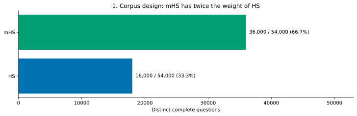

What it shows. The number of distinct cases by family. How to read it. Bar length is a case count; each case is submitted to all six models.

What we find. mHS contributes 36,000 cases and HS 18,000. Thus mHS has twice the weight in each overall rate. What it cannot show. A larger family does not establish that its questions are harder or more representative of general reasoning.

| Family | Datasets | Strata | Cases per stratum | Cases per model |
| --- | --- | --- | --- | --- |
| HS | 9 | 36 | 500 | 18,000 |
| mHS | 9 | 72 | 500 | 36,000 |
| Total | 18 | 108 | 500 | 54,000 |

Each family crosses three lexical conditions and three verbal times. Each HS dataset has four observed order/label strata. Each mHS dataset has eight strata, adding two formulations. The full observed design is in tables/design.csv. Only observed combinations enter the analysis; absent combinations are not zeros.

## 2. Which models and conditions were compared

| Exact model identifier | Provider / tier | Reasoning policy / effort |
| --- | --- | --- |
| openai/gpt-4o-mini | openai / default | not supported / not set |
| openai/gpt-6-luna | openai/flex / flex | disabled / not set |
| anthropic/claude-haiku-5.5 | anthropic / default | disabled / medium |
| anthropic/claude-sonnet-5.5 | anthropic / default | enabled / low |
| google/gemini-3.1-flash-lite | google-ai-studio/flex / flex | disabled / not set |
| google/gemini-3.5-flash-lite | google-ai-studio/flex / flex | enabled / minimal |

All models have a maximum output of 1,024 tokens and no provider fallbacks. Prompt caching is disabled. Temperature and seed were omitted, so repeated outputs are not guaranteed to be identical. Reasoning is enabled for Sonnet 5.5 at low effort and Gemini 3.5 Flash-Lite at minimal effort. Reported reasoning tokens are zero when present; that telemetry does not establish that internal reasoning was absent. Archived cards and the full frozen policy remain in the source report bundle.

Compare individual model/provider/reasoning conditions. The earlier/later metadata does not define equivalent model generations. In particular, Haiku and Sonnet are different families. This is not an isolated test of model size, generation, provider, or reasoning effort.

## 3. Four measures, four different questions

| Measure | Numerator / denominator | Question |
| --- | --- | --- |
| Agreement | Matches / interpretable responses | When we can interpret an answer, does it match the label? |
| Coverage | Interpretable responses / all planned cases | How often do we obtain a usable yes/no interpretation? |
| Strict format | Only yes or no / all planned cases | How often does the model follow the output instruction? |
| Matches over total | Matches / all planned cases | How many planned questions produce a matching answer? |

Interpretation uses the saved source-label-deterministic-v3 scores and initial_or_final_line_v2 extraction. Strict format allows only yes or no after trimming spaces and ignoring case. Some explanations, punctuation, bold answers, and complete final conclusions can be interpreted but fail strict format. Ambiguous, filtered, empty, invalid-format, and error outcomes are not converted to no. They remain separate categories in every derived table.

| Model | Matches / total | Agreement | Coverage | Strict format |
| --- | --- | --- | --- | --- |
| GPT-4o mini | 41,234/54,000 (76.36%) | 41,234/53,999 (76.36%) | 53,999/54,000 (100.00%) | 50,235/54,000 (93.03%) |
| GPT-6 Luna Flex | 45,492/54,000 (84.24%) | 45,492/54,000 (84.24%) | 54,000/54,000 (100.00%) | 54,000/54,000 (100.00%) |
| Haiku 5.5 | 41,212/54,000 (76.32%) | 41,212/53,648 (76.82%) | 53,648/54,000 (99.35%) | 53,642/54,000 (99.34%) |
| Sonnet 5.5 | 53,973/54,000 (99.95%) | 53,973/53,995 (99.96%) | 53,995/54,000 (99.99%) | 44,350/54,000 (82.13%) |
| Gemini 3.1 Flash-Lite Flex | 53,957/54,000 (99.92%) | 53,957/54,000 (99.92%) | 54,000/54,000 (100.00%) | 53,961/54,000 (99.93%) |
| Gemini 3.5 Flash-Lite Flex | 52,648/54,000 (97.50%) | 52,648/54,000 (97.50%) | 54,000/54,000 (100.00%) | 53,988/54,000 (99.98%) |

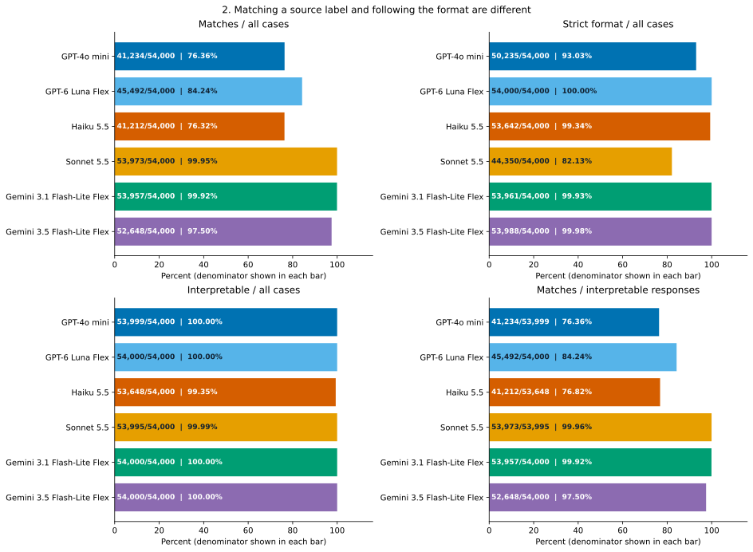

What it shows. Matches, strict format, coverage, and agreement by model. How to read it. Three panels use all cases; agreement uses interpretable responses. Each bar gives its numerator, denominator, and percentage.

What we find. The model with the most matches need not have the most strict-format responses. Luna follows the format on all 54,000 cases, but its answers do not all match the source labels. What it cannot show. Format compliance is not evidence of logical correctness, and a longer response is not automatically a wrong interpretation.

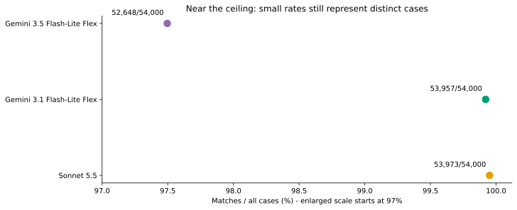

What it shows. The high-match models on an enlarged scale. How to read it. This axis starts at 97%, not zero. Use the counts to judge the absolute differences.

What we find. Sonnet has 53,973 matches; Gemini 3.1 has 53,957. Their absolute difference is 16 matches over 54,000 cases. Their format behavior differs substantially. What it cannot show. One execution does not establish a stable advantage on repeated requests or other corpora.

## 4. Family changes the reading

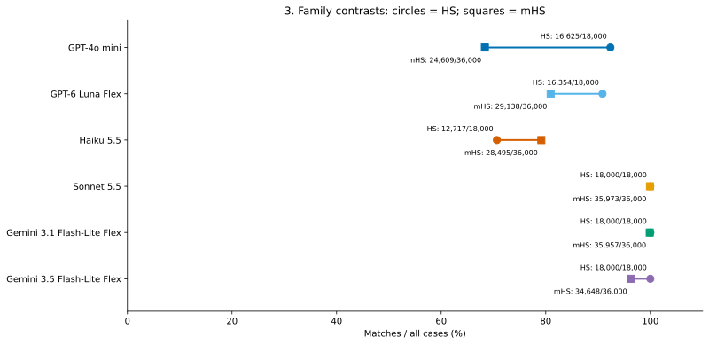

What it shows. HS and mHS matches over all cases for each model. How to read it. Circles mark HS; squares mark mHS. The line connects two descriptive rates, not paired variants of the same sentence.

What we find. GPT-4o mini and Luna have lower matches on mHS. Haiku has higher matches on mHS than HS. Sonnet and both Gemini models match all HS labels in this run. What it cannot show. Family, formulation, vocabulary, and case composition differ. This plot alone cannot identify a cause.

| Model | HS matches | mHS matches | mHS minus HS (pp) |
| --- | --- | --- | --- |
| GPT-4o mini | 16,625/18,000 (92.36%) | 24,609/36,000 (68.36%) | -24.00 |
| GPT-6 Luna Flex | 16,354/18,000 (90.86%) | 29,138/36,000 (80.94%) | -9.92 |
| Haiku 5.5 | 12,717/18,000 (70.65%) | 28,495/36,000 (79.15%) | +8.50 |
| Sonnet 5.5 | 18,000/18,000 (100.00%) | 35,973/36,000 (99.92%) | -0.08 |
| Gemini 3.1 Flash-Lite Flex | 18,000/18,000 (100.00%) | 35,957/36,000 (99.88%) | -0.12 |
| Gemini 3.5 Flash-Lite Flex | 18,000/18,000 (100.00%) | 34,648/36,000 (96.24%) | -3.76 |

The overall mean is one-third of the HS rate plus two-thirds of the mHS rate when the denominator is all cases. It is not an equal-weight family comparison. Keep the family table beside any overall ranking.

## 5. Order and labels expose the largest contrasts

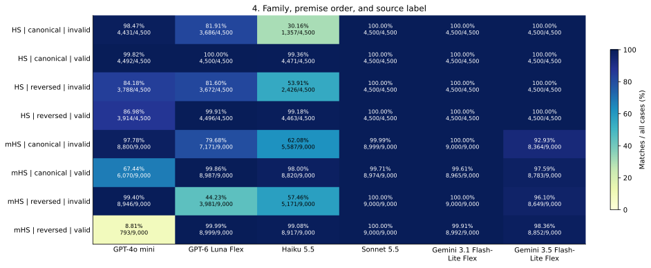

What it shows. Matches within family, premise order, and source label. How to read it. Every cell gives matches / planned cases. Color uses a common 0-100% scale.

What we find. GPT-4o mini is particularly low on reversed mHS with a valid label. Luna is lowest on reversed mHS with an invalid label. Haiku is lowest on canonical HS with an invalid label. The weak groups are not the same across models. What it cannot show. Order associations do not prove an order effect: this analysis does not establish matched sentence pairs across orders.

| Model | Family | Order | Source label | Lowest observed group |
| --- | --- | --- | --- | --- |
| GPT-4o mini | mHS | non-canonic | valid | 793/9,000 (8.81%) |
| GPT-6 Luna Flex | mHS | non-canonic | invalid | 3,981/9,000 (44.23%) |
| Haiku 5.5 | HS | canonic | invalid | 1,357/4,500 (30.16%) |
| Sonnet 5.5 | mHS | canonic | valid | 8,974/9,000 (99.71%) |
| Gemini 3.1 Flash-Lite Flex | mHS | canonic | valid | 8,965/9,000 (99.61%) |
| Gemini 3.5 Flash-Lite Flex | mHS | canonic | invalid | 8,364/9,000 (92.93%) |

These are the lowest groups selected after inspecting the complete table. They locate patterns for review, not independently tested hypotheses. For a valid target, an interpreted no is a disagreement; for an invalid target, an interpreted yes is a disagreement. A broad tendency to answer yes or no can therefore look very different across labels.

| Model / family / source label | Yes / interpreted | No / interpreted |
| --- | --- | --- |
| Haiku 5.5 / HS / invalid | 5,148/8,931 (57.64%) | 3,783/8,931 (42.36%) |
| Haiku 5.5 / HS / valid | 8,934/8,934 (100.00%) | 0/8,934 (0.00%) |
| Haiku 5.5 / mHS / invalid | 7,089/17,847 (39.72%) | 10,758/17,847 (60.28%) |
| Haiku 5.5 / mHS / valid | 17,737/17,936 (98.89%) | 199/17,936 (1.11%) |
| Sonnet 5.5 / HS / invalid | 0/9,000 (0.00%) | 9,000/9,000 (100.00%) |
| Sonnet 5.5 / HS / valid | 9,000/9,000 (100.00%) | 0/9,000 (0.00%) |
| Sonnet 5.5 / mHS / invalid | 0/17,999 (0.00%) | 17,999/17,999 (100.00%) |
| Sonnet 5.5 / mHS / valid | 17,974/17,996 (99.88%) | 22/17,996 (0.12%) |
| Gemini 3.1 Flash-Lite Flex / HS / invalid | 0/9,000 (0.00%) | 9,000/9,000 (100.00%) |
| Gemini 3.1 Flash-Lite Flex / HS / valid | 9,000/9,000 (100.00%) | 0/9,000 (0.00%) |
| Gemini 3.1 Flash-Lite Flex / mHS / invalid | 0/18,000 (0.00%) | 18,000/18,000 (100.00%) |
| Gemini 3.1 Flash-Lite Flex / mHS / valid | 17,957/18,000 (99.76%) | 43/18,000 (0.24%) |
| Gemini 3.5 Flash-Lite Flex / HS / invalid | 0/9,000 (0.00%) | 9,000/9,000 (100.00%) |
| Gemini 3.5 Flash-Lite Flex / HS / valid | 9,000/9,000 (100.00%) | 0/9,000 (0.00%) |
| Gemini 3.5 Flash-Lite Flex / mHS / invalid | 987/18,000 (5.48%) | 17,013/18,000 (94.52%) |
| Gemini 3.5 Flash-Lite Flex / mHS / valid | 17,635/18,000 (97.97%) | 365/18,000 (2.03%) |
| GPT-4o mini / HS / invalid | 781/9,000 (8.68%) | 8,219/9,000 (91.32%) |
| GPT-4o mini / HS / valid | 8,406/8,999 (93.41%) | 593/8,999 (6.59%) |
| GPT-4o mini / mHS / invalid | 254/18,000 (1.41%) | 17,746/18,000 (98.59%) |
| GPT-4o mini / mHS / valid | 6,863/18,000 (38.13%) | 11,137/18,000 (61.87%) |
| GPT-6 Luna Flex / HS / invalid | 1,642/9,000 (18.24%) | 7,358/9,000 (81.76%) |
| GPT-6 Luna Flex / HS / valid | 8,996/9,000 (99.96%) | 4/9,000 (0.04%) |
| GPT-6 Luna Flex / mHS / invalid | 6,848/18,000 (38.04%) | 11,152/18,000 (61.96%) |
| GPT-6 Luna Flex / mHS / valid | 17,986/18,000 (99.92%) | 14/18,000 (0.08%) |

## 6. Formulation, vocabulary, and tense

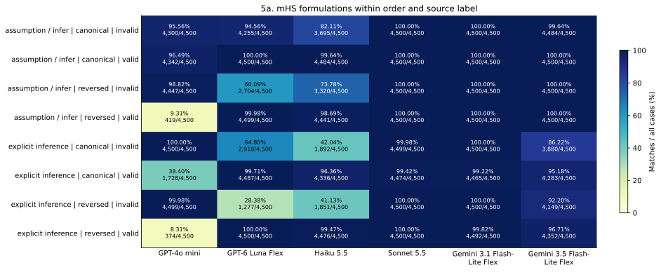

What it shows. The two mHS formulations within order and label. How to read it. Read across models within one row before comparing rows. Counts use the observed subgroup, not all mHS cases.

What we find. The explicit-inference formulation contains especially low groups for mini and Luna. Gemini 3.5 also has its largest local deficit in explicit-inference, canonical, invalid-labeled cases. What it cannot show. A phrasing association is not proof that the connective itself caused the response.

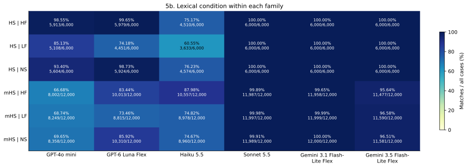

What it shows. Lexical conditions within HS and mHS. How to read it. HF, LF, and NS are separate source conditions. Each cell pools tense, order, labels, and applicable formulations.

What we find. The differences are model-specific. For example, Haiku&#x27;s lowest HS lexical group is LF, while GPT-4o mini&#x27;s lowest mHS lexical group is HF. What it cannot show. These pooled rates do not measure an isolated word-frequency mechanism or a general language ability.

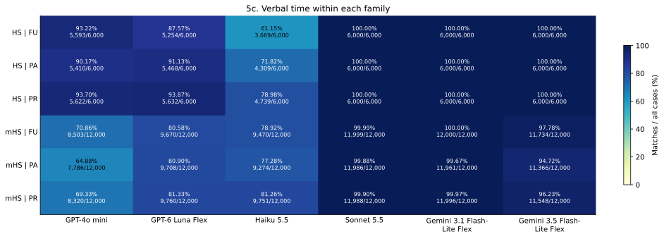

What it shows. Verbal-time conditions within HS and mHS. How to read it. PA is past, PR present, and FU future. Use the same color scale and the cell denominators.

What we find. Temporal patterns are smaller than some order/label contrasts, but not uniform across models. The complete stratum table allows the pooled patterns to be checked at finer resolution. What it cannot show. A tense association can reflect other details of the particular questions. No causal effect is estimated.

Tables/formulation.csv, lexical.csv, tense.csv, and stratum.csv contain all counts, coverage, format, answer categories, and rates behind these plots. The stratum table has 648 model/stratum rows with 500 cases each. Do not treat the visually selected low groups as the only results.

## 7. Do models disagree on the same cases?

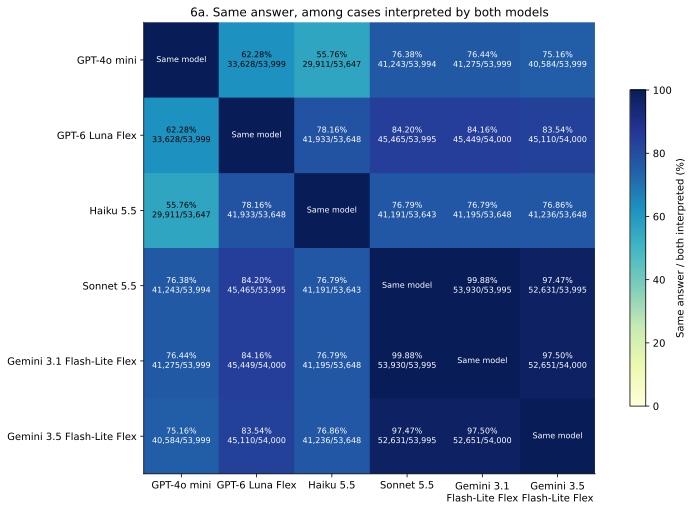

What it shows. Agreement between every pair of model answers. How to read it. The denominator contains only cases interpreted by both models. The diagonal is the same model, not an independent repeat.

What we find. High answer agreement indicates similar decisions on the same UIDs. Low agreement locates different response patterns. It does not by itself tell which model matches the source label. What it cannot show. Agreement between models is neither an independent logical audit nor a measure of response stability.

| Model A / Model B | Both interpreted / 54,000 | Same answer / both | Only A matches | Only B matches |
| --- | --- | --- | --- | --- |
| Haiku 5.5 / Sonnet 5.5 | 53,643/54,000 (99.34%) | 41,191/53,643 (76.79%) | 19/53,643 (0.04%) | 12,433/53,643 (23.18%) |
| Haiku 5.5 / Gemini 3.1 Flash-Lite Flex | 53,648/54,000 (99.35%) | 41,195/53,648 (76.79%) | 30/53,648 (0.06%) | 12,423/53,648 (23.16%) |
| Haiku 5.5 / Gemini 3.5 Flash-Lite Flex | 53,648/54,000 (99.35%) | 41,236/53,648 (76.86%) | 664/53,648 (1.24%) | 11,748/53,648 (21.90%) |
| Haiku 5.5 / GPT-4o mini | 53,647/54,000 (99.35%) | 29,911/53,647 (55.76%) | 12,004/53,647 (22.38%) | 11,732/53,647 (21.87%) |
| Haiku 5.5 / GPT-6 Luna Flex | 53,648/54,000 (99.35%) | 41,933/53,648 (78.16%) | 3,881/53,648 (7.23%) | 7,834/53,648 (14.60%) |
| Sonnet 5.5 / Gemini 3.1 Flash-Lite Flex | 53,995/54,000 (99.99%) | 53,930/53,995 (99.88%) | 43/53,995 (0.08%) | 22/53,995 (0.04%) |
| Sonnet 5.5 / Gemini 3.5 Flash-Lite Flex | 53,995/54,000 (99.99%) | 52,631/53,995 (97.47%) | 1,347/53,995 (2.49%) | 17/53,995 (0.03%) |
| Sonnet 5.5 / GPT-4o mini | 53,994/54,000 (99.99%) | 41,243/53,994 (76.38%) | 12,747/53,994 (23.61%) | 4/53,994 (0.01%) |
| Sonnet 5.5 / GPT-6 Luna Flex | 53,995/54,000 (99.99%) | 45,465/53,995 (84.20%) | 8,508/53,995 (15.76%) | 22/53,995 (0.04%) |
| Gemini 3.1 Flash-Lite Flex / Gemini 3.5 Flash-Lite Flex | 54,000/54,000 (100.00%) | 52,651/54,000 (97.50%) | 1,329/54,000 (2.46%) | 20/54,000 (0.04%) |
| Gemini 3.1 Flash-Lite Flex / GPT-4o mini | 53,999/54,000 (100.00%) | 41,275/53,999 (76.44%) | 12,723/53,999 (23.56%) | 1/53,999 (0.00%) |
| Gemini 3.1 Flash-Lite Flex / GPT-6 Luna Flex | 54,000/54,000 (100.00%) | 45,449/54,000 (84.16%) | 8,508/54,000 (15.76%) | 43/54,000 (0.08%) |
| Gemini 3.5 Flash-Lite Flex / GPT-4o mini | 53,999/54,000 (100.00%) | 40,584/53,999 (75.16%) | 12,414/53,999 (22.99%) | 1,001/53,999 (1.85%) |
| Gemini 3.5 Flash-Lite Flex / GPT-6 Luna Flex | 54,000/54,000 (100.00%) | 45,110/54,000 (83.54%) | 8,023/54,000 (14.86%) | 867/54,000 (1.61%) |
| GPT-4o mini / GPT-6 Luna Flex | 53,999/54,000 (100.00%) | 33,628/53,999 (62.28%) | 8,057/53,999 (14.92%) | 12,314/53,999 (22.80%) |

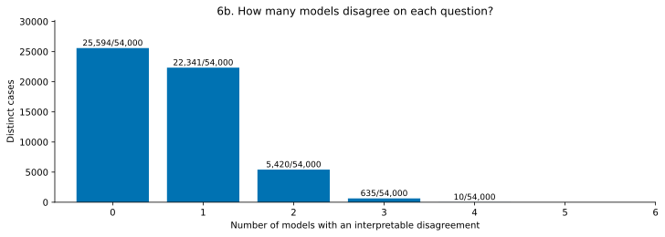

What it shows. The count of disagreeing models for each question. How to read it. Count only interpreted answers that disagree with the source label. A bar at zero can still contain a filtered or otherwise uninterpretable answer.

What we find. There are 22,341 cases with one disagreeing model and 6,065 with two or more. Another 25,594 have no interpreted disagreement. Shared disagreement is a useful queue for manual review of prompts, labels, and model answers. What it cannot show. Even unanimous disagreement would not prove that a source label is wrong. Models can share mistakes.

## 8. Usable answers and strict format

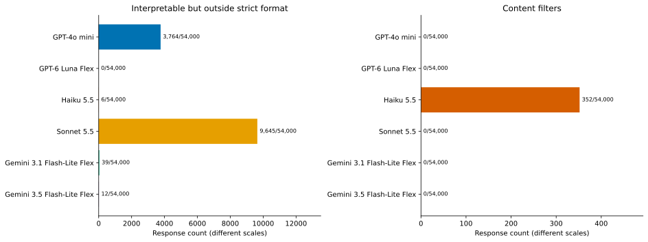

What it shows. Interpretable format violations and content filters. How to read it. These are counts over 54,000 responses per model. The two panels have different count scales.

What we find. Sonnet supplies many interpretable responses outside the requested format. Haiku accounts for the content filters. These are different operational problems: parsing can recover some format violations, but cannot recover a filtered answer. What it cannot show. The deterministic parser does not certify that an explanation is logically sound. Filters do not imply a yes or no answer.

| Model | Interpretable non-strict | Filters | Empty | Ambiguous | Invalid format | Output error |
| --- | --- | --- | --- | --- | --- | --- |
| GPT-4o mini | 3764 | 0 | 0 | 0 | 1 | 0 |
| GPT-6 Luna Flex | 0 | 0 | 0 | 0 | 0 | 0 |
| Haiku 5.5 | 6 | 352 | 0 | 0 | 0 | 0 |
| Sonnet 5.5 | 9645 | 0 | 0 | 5 | 0 | 0 |
| Gemini 3.1 Flash-Lite Flex | 39 | 0 | 0 | 0 | 0 | 0 |
| Gemini 3.5 Flash-Lite Flex | 12 | 0 | 0 | 0 | 0 | 0 |

All category counts in this table use 54,000 planned responses per model. Full category counts by condition are included in every cross-condition CSV. Final execution errors and scorer output-error categories are distinct; neither is folded into a negative answer.

Haiku filters occur in these lexical groups: HS LF: 22/6,000 (0.37%); HS NS: 113/6,000 (1.88%); mHS LF: 54/12,000 (0.45%); mHS NS: 163/12,000 (1.36%). There are no HF filters. This distribution does not establish why the provider filtered a request.

## 9. Original cases for close reading

The following cases are selected by ascending SHA-256 of the UID within each family and category: model disagreement, filter, and interpretable non-strict output. A case is never reused. This deterministic rule makes examples reproducible, not statistically representative. All six raw responses are shown. The source labels remain unchanged and any logical concern needs a separate audit.

### HS: different answers

UID: HS_NS_FU_2000:955:ecd5d089ff37fde8. Source: prompts/userPrompts/HS_NS_FU_500_complete.json; row 955. Source label: invalid; target: no. Conditions: NS, FU, canonic; if then / therefore.

<pre>If the preggar will glash the ploodnum, then the probeller will trelf the blorrack; if the probeller will trelf the blorrack, then the bruggant will frike the drambet; therefore if the bruggant will frike the drambet, then the preggar will glash the ploodnum?</pre>

Haiku 5.5: category answered; interpretation yes; matched 0; strict format 1. Raw response:

<pre>yes</pre>

Sonnet 5.5: category answered; interpretation no; matched 1; strict format 1. Raw response:

<pre>no</pre>

Gemini 3.1 Flash-Lite Flex: category answered; interpretation no; matched 1; strict format 1. Raw response:

<pre>no</pre>

Gemini 3.5 Flash-Lite Flex: category answered; interpretation no; matched 1; strict format 1. Raw response:

<pre>no</pre>

GPT-4o mini: category answered; interpretation no; matched 1; strict format 1. Raw response:

<pre>no</pre>

GPT-6 Luna Flex: category answered; interpretation no; matched 1; strict format 1. Raw response:

<pre>no</pre>

Reading: compare the raw response with the stored interpretation before comparing it with the target. This case illustrates the named category; it does not establish the frequency or cause of that behavior.

### HS: content filter

UID: HS_NS_PR_2000:37:7f42d42c0023eb28. Source: prompts/userPrompts/HS_NS_PR_500_complete.json; row 37. Source label: valid; target: yes. Conditions: NS, PR, canonic; if then / therefore.

<pre>If the preggar gresks the prebart, then the brettent glashes the flendop; if the brettent glashes the flendop, then the probeller frikes the ploodnum; therefore if the preggar gresks the prebart, then the probeller frikes the ploodnum?</pre>

Haiku 5.5: category content_filter; interpretation none; matched 0; strict format 0. Raw response:

<pre>This request triggered restrictions on content related to the development of high-yield explosives and was blocked under Anthropic&#x27;s Usage Policy. To learn more, provide feedback, or request an exemption based on how you use Claude, visit our help center: https://support.claude.com/ API integrators: you can reduce refusals for your users by configuring a fallback model — see https://platform.claude.com/docs/en/build-with-claude/refusals-and-fallback</pre>

Sonnet 5.5: category answered; interpretation yes; matched 1; strict format 1. Raw response:

<pre>yes</pre>

Gemini 3.1 Flash-Lite Flex: category answered; interpretation yes; matched 1; strict format 1. Raw response:

<pre>yes</pre>

Gemini 3.5 Flash-Lite Flex: category answered; interpretation yes; matched 1; strict format 1. Raw response:

<pre>yes</pre>

GPT-4o mini: category answered; interpretation yes; matched 1; strict format 1. Raw response:

<pre>yes</pre>

GPT-6 Luna Flex: category answered; interpretation yes; matched 1; strict format 1. Raw response:

<pre>yes</pre>

Reading: compare the raw response with the stored interpretation before comparing it with the target. This case illustrates the named category; it does not establish the frequency or cause of that behavior.

### HS: interpretable outside strict format

UID: HS_HF_FU_2000:1602:787e8fed73f8e1dc. Source: prompts/userPrompts/HS_HF_FU_500_complete.json; row 1602. Source label: invalid; target: no. Conditions: HF, FU, non-canonic; if then / therefore.

<pre>If the student will hate the computer, then the family will see the college; if the doctor will win the game, then the student will hate the computer; therefore if the family will see the college, then the doctor will win the game?</pre>

Haiku 5.5: category answered; interpretation no; matched 1; strict format 1. Raw response:

<pre>no</pre>

Sonnet 5.5: category answered; interpretation no; matched 1; strict format 0. Raw response:

<pre>Let H = the student will hate the computer, F = the family will see the college, D = the doctor will win the game.

The premises are H → F and D → H. Chaining them gives D → F.

The conclusion asks for F → D, which is the converse of D → F. The premises do not support it. For example, if F is true while D and H are both false, both premises hold and the conclusion fails.

No</pre>

Gemini 3.1 Flash-Lite Flex: category answered; interpretation no; matched 1; strict format 1. Raw response:

<pre>no</pre>

Gemini 3.5 Flash-Lite Flex: category answered; interpretation no; matched 1; strict format 1. Raw response:

<pre>no</pre>

GPT-4o mini: category answered; interpretation no; matched 1; strict format 1. Raw response:

<pre>no</pre>

GPT-6 Luna Flex: category answered; interpretation no; matched 1; strict format 1. Raw response:

<pre>no</pre>

Reading: compare the raw response with the stored interpretation before comparing it with the target. This case illustrates the named category; it does not establish the frequency or cause of that behavior.

### mHS: different answers

UID: mHS_HF_PR_4000:1953:d7b258905cf06b38. Source: prompts/userPrompts/mHS_HF_PR_500_complete.json; row 1953. Source label: invalid; target: no. Conditions: HF, PR, canonic; from the inference (therefore) / does the inference follow.

<pre>From the inference &#x27;the woman pays the sugar, therefore the girl hates the school&#x27;, and the inference &#x27;the girl hates the school, therefore the officer finds the college&#x27;, does the inference &#x27;the officer finds the college, therefore the woman pays the sugar&#x27; follow?</pre>

Haiku 5.5: category answered; interpretation no; matched 1; strict format 1. Raw response:

<pre>no</pre>

Sonnet 5.5: category answered; interpretation no; matched 1; strict format 1. Raw response:

<pre>no</pre>

Gemini 3.1 Flash-Lite Flex: category answered; interpretation no; matched 1; strict format 1. Raw response:

<pre>no</pre>

Gemini 3.5 Flash-Lite Flex: category answered; interpretation no; matched 1; strict format 1. Raw response:

<pre>no</pre>

GPT-4o mini: category answered; interpretation no; matched 1; strict format 1. Raw response:

<pre>no</pre>

GPT-6 Luna Flex: category answered; interpretation yes; matched 0; strict format 1. Raw response:

<pre>yes</pre>

Reading: compare the raw response with the stored interpretation before comparing it with the target. This case illustrates the named category; it does not establish the frequency or cause of that behavior.

### mHS: content filter

UID: mHS_NS_FU_4000:1062:cbe3c3e2be728394. Source: prompts/userPrompts/mHS_NS_FU_500_complete.json; row 1062. Source label: invalid; target: no. Conditions: NS, FU, canonic; assuming that we can infer / thus.

<pre>Assuming that the bruggant will trelf the drambet, we can infer that the preggar will prant the ploodnum. Assuming that the preggar will prant the ploodnum, we can infer that the probeller will glash the prebart. Thus, assuming that the probeller will glash the prebart, can we infer that the bruggant will trelf the drambet?</pre>

Haiku 5.5: category content_filter; interpretation none; matched 0; strict format 0. Raw response:

<pre>This request triggered restrictions on content related to the development of high-yield explosives and was blocked under Anthropic&#x27;s Usage Policy. To learn more, provide feedback, or request an exemption based on how you use Claude, visit our help center: https://support.claude.com/ API integrators: you can reduce refusals for your users by configuring a fallback model — see https://platform.claude.com/docs/en/build-with-claude/refusals-and-fallback</pre>

Sonnet 5.5: category answered; interpretation no; matched 1; strict format 1. Raw response:

<pre>no</pre>

Gemini 3.1 Flash-Lite Flex: category answered; interpretation no; matched 1; strict format 1. Raw response:

<pre>no</pre>

Gemini 3.5 Flash-Lite Flex: category answered; interpretation no; matched 1; strict format 1. Raw response:

<pre>no</pre>

GPT-4o mini: category answered; interpretation no; matched 1; strict format 1. Raw response:

<pre>no</pre>

GPT-6 Luna Flex: category answered; interpretation yes; matched 0; strict format 1. Raw response:

<pre>yes</pre>

Reading: compare the raw response with the stored interpretation before comparing it with the target. This case illustrates the named category; it does not establish the frequency or cause of that behavior.

### mHS: interpretable outside strict format

UID: mHS_HF_PR_4000:153:99c4ec3b9f63ae06. Source: prompts/userPrompts/mHS_HF_PR_500_complete.json; row 153. Source label: valid; target: yes. Conditions: HF, PR, canonic; assuming that we can infer / thus.

<pre>Assuming that the family pays the computer, we can infer that the man loses the game. Assuming that the man loses the game, we can infer that the woman hates the school. Thus, assuming that the family pays the computer, can we infer that the woman hates the school?</pre>

Haiku 5.5: category answered; interpretation yes; matched 1; strict format 1. Raw response:

<pre>yes</pre>

Sonnet 5.5: category answered; interpretation yes; matched 1; strict format 1. Raw response:

<pre>yes</pre>

Gemini 3.1 Flash-Lite Flex: category answered; interpretation yes; matched 1; strict format 1. Raw response:

<pre>yes</pre>

Gemini 3.5 Flash-Lite Flex: category answered; interpretation yes; matched 1; strict format 1. Raw response:

<pre>Yes</pre>

GPT-4o mini: category answered; interpretation yes; matched 1; strict format 0. Raw response:

<pre>Yes.</pre>

GPT-6 Luna Flex: category answered; interpretation yes; matched 1; strict format 1. Raw response:

<pre>yes</pre>

Reading: compare the raw response with the stored interpretation before comparing it with the target. This case illustrates the named category; it does not establish the frequency or cause of that behavior.

## 10. Cost and time: secondary decision evidence

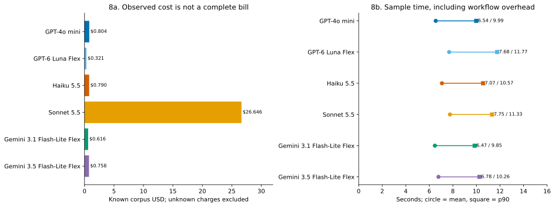

What it shows. Known corpus costs and observed sample durations. How to read it. Costs include known final and additional-attempt charges. Time markers show mean and p90 for 54,000 observed samples per model.

What we find. Sonnet accounts for most of the known cost. Sample times are much closer than costs. A low cost or short sample time does not repair a source-label disagreement. What it cannot show. Missing charges prevent a complete bill. Concurrent sample durations cannot be added to infer elapsed run time or used as a guaranteed future speed.

| Phase / model / role | Generation IDs | Known IDs | Unknown IDs | Known USD |
| --- | --- | --- | --- | --- |
| corpus / Haiku 5.5 / final | 54000 | 53648 | 352 | 0.78982540 |
| corpus / Sonnet 5.5 / final | 54000 | 54000 | 0 | 26.64599400 |
| corpus / Gemini 3.1 Flash-Lite Flex / final | 54000 | 54000 | 0 | 0.61577625 |
| corpus / Gemini 3.5 Flash-Lite Flex / final | 54000 | 54000 | 0 | 0.75781140 |
| corpus / GPT-4o mini / final | 54000 | 54000 | 0 | 0.80419140 |
| corpus / GPT-6 Luna Flex / additional | 426 | 0 | 426 | unknown |
| corpus / GPT-6 Luna Flex / final | 54000 | 54000 | 0 | 0.32131830 |
| correction_preflight / Haiku 5.5 / final | 1 | 1 | 0 | 0.00001080 |
| correction_preflight / Sonnet 5.5 / final | 1 | 1 | 0 | 0.00021800 |
| correction_preflight / Gemini 3.1 Flash-Lite Flex / final | 1 | 1 | 0 | 0.00000812 |
| correction_preflight / Gemini 3.5 Flash-Lite Flex / final | 1 | 1 | 0 | 0.00001010 |
| correction_preflight / GPT-4o mini / final | 1 | 1 | 0 | 0.00001080 |
| correction_preflight / GPT-6 Luna Flex / final | 1 | 1 | 0 | 0.00000460 |
| preflight / Haiku 5.5 / final | 1 | 1 | 0 | 0.00001160 |
| preflight / Sonnet 5.5 / final | 1 | 1 | 0 | 0.00023400 |
| preflight / Gemini 3.1 Flash-Lite Flex / final | 1 | 1 | 0 | 0.00000888 |
| preflight / Gemini 3.5 Flash-Lite Flex / final | 1 | 1 | 0 | 0.00001100 |
| preflight / GPT-4o mini / final | 1 | 1 | 0 | 0.00001170 |
| preflight / GPT-6 Luna Flex / final | 1 | 1 | 0 | 0.00000490 |
| superseded / Haiku 5.5 / historical replaced calls | 612 | 612 | 0 | 0.00743430 |
| superseded / Sonnet 5.5 / historical replaced calls | 612 | 612 | 0 | 0.23166000 |
| superseded / Gemini 3.1 Flash-Lite Flex / historical replaced calls | 612 | 612 | 0 | 0.00571200 |
| superseded / Gemini 3.5 Flash-Lite Flex / historical replaced calls | 612 | 612 | 0 | 0.00706985 |
| superseded / GPT-4o mini / historical replaced calls | 612 | 612 | 0 | 0.00754980 |
| superseded / GPT-6 Luna Flex / historical replaced calls | 613 | 612 | 1 | 0.00312120 |

| Phase / model | Input tokens | Output tokens | Reported reasoning tokens | Missing input / output / reasoning |
| --- | --- | --- | --- | --- |
| corpus / Haiku 5.5 | 6894599 | 200731 | 0 | 352 / 352 / 352 |
| corpus / Sonnet 5.5 | 6996312 | 1265337 | 0 | 0 / 0 / 0 |
| corpus / Gemini 3.1 Flash-Lite Flex | 4601976 | 54039 | 0 | 0 / 0 / 0 |
| corpus / Gemini 3.5 Flash-Lite Flex | 4601976 | 54012 | 0 | 0 / 0 / 0 |
| corpus / GPT-4o mini | 5130216 | 57765 | 0 | 0 / 0 / 0 |
| corpus / GPT-6 Luna Flex | 5076216 | 270030 | 0 | 0 / 0 / 0 |
| correction_preflight / Haiku 5.5 | 88 | 4 | 0 | 0 / 0 / 0 |
| correction_preflight / Sonnet 5.5 | 89 | 4 | 0 | 0 / 0 / 0 |
| correction_preflight / Gemini 3.1 Flash-Lite Flex | 59 | 1 | 0 | 0 / 0 / 0 |
| correction_preflight / Gemini 3.5 Flash-Lite Flex | 59 | 1 | 0 | 0 / 0 / 0 |
| correction_preflight / GPT-4o mini | 68 | 1 | 0 | 0 / 0 / 0 |
| correction_preflight / GPT-6 Luna Flex | 67 | 5 | 0 | 0 / 0 / 0 |
| preflight / Haiku 5.5 | 96 | 4 | 0 | 0 / 0 / 0 |
| preflight / Sonnet 5.5 | 97 | 4 | 0 | 0 / 0 / 0 |
| preflight / Gemini 3.1 Flash-Lite Flex | 65 | 1 | 0 | 0 / 0 / 0 |
| preflight / Gemini 3.5 Flash-Lite Flex | 65 | 1 | 0 | 0 / 0 / 0 |
| preflight / GPT-4o mini | 74 | 1 | 0 | 0 / 0 / 0 |
| preflight / GPT-6 Luna Flex | 73 | 5 | 0 | 0 / 0 / 0 |

Known costs for retained and replacement corpus responses total USD 29.93491675. The original preflight adds USD 0.000282075. The cost table separately records superseded calls and the correction preflight. Unknown charges remain unknown; these totals are not a complete bill.

Original execution only. The evaluation interval was 3.42 hours, followed by 15.61 minutes of closure/export. Including startup, total duration was 3.69 hours. These are observed workflow intervals, not pure model generation time. The run used six active tasks, 32 sample slots per task, and adaptive per-model connections. The source report contains the operational telemetry and its limitations. The separate replacement corpus phase took 3.19 minutes including closure. The composite has no continuous execution duration.

Charges are deduplicated by generation ID in the source ledger. Unknown costs remain unknown; known zero charges remain zero. Preflight stays separate. Additional attempts are cost evidence, not additional independent corpus answers. This analysis does not extrapolate a new full-corpus cost because the full corpus has already been run.

## 11. Conclusions and next analyses

For this corpus and these fixed conditions, Gemini 3.1 Flash-Lite combines very high source-label agreement, near-complete strict format, and low known cost. Sonnet has slightly more matching answers but many more format violations and a much higher known cost. This supports a practical shortlist, not a universal recommendation or a claim that one model reasons better in general.

Do not select mini, Luna, or Haiku from the overall mean alone. Their condition profiles differ sharply. A system that needs a specific type of mHS question can encounter much lower agreement than the model&#x27;s average. For Gemini 3.5, the perfect HS result also hides mHS disagreements. A newer label does not guarantee a better result on this task.

Next, conduct a separate logical audit of a prespecified selection from low-agreement groups and shared disagreements. Include controls from high-agreement groups to avoid reviewing only failures. Preserve the source labels and publish any audited labels as a new version. Then use repeated independent runs on a fixed subset to measure response variation. Neither step is performed here.

Possible mechanisms include response tendencies, sensitivity to formulation, and problems in source labels. These are hypotheses, not findings established by this execution. Model versions, providers, tiers, and reasoning controls differ together. The corpus is structured and finite; it does not sample all language or reasoning tasks.

## 12. Reproduction and data checks

All numbers and figures come from the derived tables in this folder. summary.json contains the same analytical data; document.json contains the shared editorial blocks used for Markdown, HTML, and the continuous PDF. provenance.json records input and analysis-source hashes. validation.json records the completed checks. Inputs were read from the validated analysis-v3 bundle, not regenerated from model requests.

Validation checks 54,000 unique cases; six model responses per UID; 108 model/dataset tasks; 108 source strata with 500 cases each; 648 model/stratum groups; and 15 model pairs. Prompt hashes and all response fields are checked between JSON and CSV. Totals, strata, pairs, and the generation cost ledger reconcile with the published report. This is a verification of the derived inputs, not a new logical audit of the original questions.

<pre>uv run --locked transitivity interpret --report reports/full/2026-11-06_01-23-40-040fd7b7/analysis-v1 --output reports/full/2026-11-06_01-23-40-040fd7b7/new-interpretation</pre>

The output directory must not exist. The command performs no provider API calls. Open index.html directly: it needs no server, JavaScript, or external assets. Original logs, scores, source records, and the earlier report remain unchanged.
